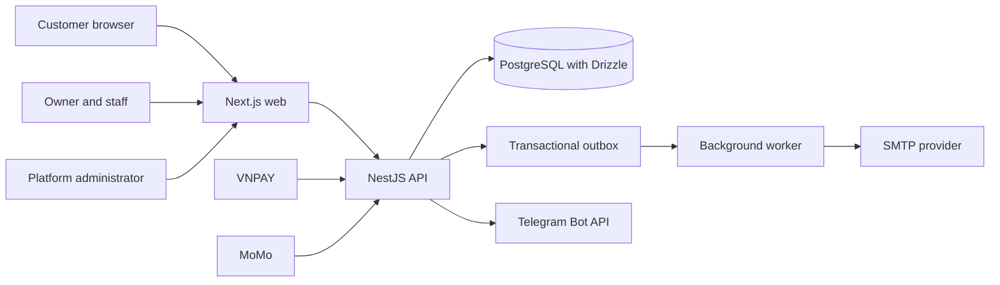

# ZenBook

ZenBook is a multi-tenant appointment platform for service businesses. Each shop manages its own services, staff, schedules, bookings and subscription from a private workspace; customers book through a public, mobile-friendly page.

This repository is a portfolio project and local development setup. It is not a production deployment.

## Product features

- **Tenant workspace:** manage services, staff expertise, opening hours, shifts, booking policies and exceptions.
- **Public booking:** customers can choose up to three services, see a combined schedule suggestion and book without creating an account.
- **Booking integrity:** server-side availability checks, atomic staff allocation, conflict protection, idempotent booking requests and tenant-scoped guest management links.
- **Platform administration:** review tenant applications; manage tenants, plans, billing, system settings and support requests.
- **Plans and payments:** enforce plan limits and process one-time monthly payments through VNPAY and MoMo provider notifications. Payment credentials are configured outside source control; use sandbox credentials for local development.
- **Notifications:** workspace notifications, appointment reminders and optional Telegram group integration. An outbox worker delivers email and retries transient failures.
- **Workspace insights:** booking trends, service mix and estimated revenue charts, plus configurable workspace themes.

## Architecture



The API owns authentication, tenant authorization, booking rules, billing state and provider webhook verification. PostgreSQL stores tenant-scoped records and transactional outbox work. The worker processes email outbox events separately from web requests.

## Technology

- Next.js and React for the web application
- NestJS and TypeScript for the API
- PostgreSQL and Drizzle ORM for persistence and migrations
- pnpm workspaces for the monorepo
- A separate Node.js worker for outbox delivery

## Run locally

### Requirements

- Node.js 20 or newer
- pnpm 10
- Docker Desktop or Docker Engine with Compose

### Setup

```powershell
Copy-Item .env.example .env
pnpm install
docker compose up -d postgres
pnpm build:runtime-packages
pnpm db:migrate
pnpm dev:all
```

The web app runs at <http://localhost:3002>, the API at <http://localhost:8002>, and the health endpoint at <http://localhost:8002/health>. `pnpm dev:all` starts the web app, API and worker together.

For the first platform administrator, SMTP, guest email delivery, Telegram, and payment sandbox setup, follow [the local operations guide](docs/operations.md). Never put real credentials in `.env.example`, source files, screenshots or commits. The local `.env` is ignored by Git.

## Design notes

- [Booking engine and scheduling rules](docs/booking-engine.md)
- [Local operations, worker and sandbox setup](docs/operations.md)

## Scope and limitations

- Payment processing requires merchant sandbox credentials and a reachable webhook URL. A browser redirect alone does not confirm payment.
- Email and Telegram integrations require tenant or platform configuration.
- The repository contains local development and operational guidance; it does not include a hosted production environment or claim production readiness.
- Do not use real customer information in a demo tenant or screenshots.
